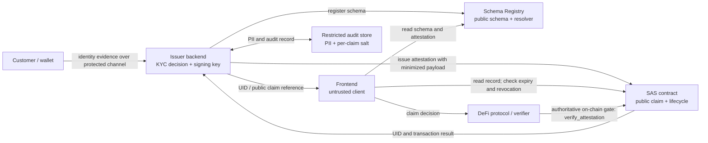

# KYC/AML verifiable credential attestation

This guide shows how to publish a KYC/AML claim through the Soroban
Attestation Service (SAS), issue it from a trusted backend with the Rust SDK,
and check it in a TypeScript application. It is an integration pattern, not a
legal or regulatory determination: the relying protocol remains responsible
for its own jurisdictional, sanctions, and risk policies.

## Trust boundaries and data flow



The customer provides evidence to the issuer backend, not to the public
contracts. The issuer makes the KYC decision, retains evidence and any
verification material in a protected off-chain system, and only publishes the
minimum claim necessary for the relying application. The frontend is not
trusted to issue or alter claims. A protocol enforcing access on-chain should
call SAS itself; a browser-side decision is only a user-interface check.

## 1. Define the claim schema

Register this schema string verbatim:

```text
identity_tier u32, jurisdiction_code String, expires_at u64, audit_hash BytesN<32>
```

| Field | Meaning |
| --- | --- |
| `identity_tier` | Issuer-defined assurance level; document its meaning and permitted values for every consumer. |
| `jurisdiction_code` | Two-letter jurisdiction code, such as `US` or `DE`; define the code set and normalization. |
| `expires_at` | Unix timestamp in seconds. Set it to the same time as the native SAS `expiration_time`. |
| `audit_hash` | SHA-256 digest binding a private audit record to this claim; it is not the record itself. |

SAS schemas are registered metadata: the schema string does **not** by itself
decode or validate arbitrary `data` bytes. This example serializes the claim
as UTF-8 JSON, with `audit_hash` as 64 lowercase hexadecimal characters and
`expires_at` as a decimal string to avoid JavaScript's integer precision
limit. The issuer must validate the shape and policy before issuance; each
verifier must parse and validate the payload against the registered schema.
A resolver can add contract-level issuance policy, but it does not replace
consumer-side validation.

Register a resolver that is deployed on the same network as SAS. Its address
is part of the schema UID along with the schema text and revocability flag.
Choose a resolver with an explicit policy; an accept-all resolver is suitable
only for development. Set the schema as revocable so an issuer can withdraw a
claim when a customer's status changes. The `expires_at` payload field and
SAS's native expiration are deliberately redundant: verifiers must require
them to match.

## 2. Register and issue from a Rust backend

The following uses the Rust SDK APIs in `soroban-sas-sdk`. The registered
schema owner and the attester are the same account in this example; use a
registry-authorized delegate if you separate those roles. Keep the secret
seed in a server-side secret manager and never pass it to a browser.

```rust
use soroban_sas_sdk::{
    attestation_builder::AttestationRequestBuilder,
    client::SASClient,
    rpc::RpcClient,
};
use soroban_sdk::{Address, Bytes, Env, String as SorobanString};
use std::error::Error;

const KYC_SCHEMA: &str =
    "identity_tier u32, jurisdiction_code String, expires_at u64, audit_hash BytesN<32>";

/// `issuer_address` must correspond to `secret_seed`.
/// `audit_hash_hex` is the 64-character salted audit digest described below.
fn register_and_issue(
    rpc_url: &str,
    network_passphrase: &str,
    registry_id: &str,
    sas_id: &str,
    resolver_id: &str,
    issuer_address: &str,
    recipient_address: &str,
    secret_seed: &[u8; 32],
    identity_tier: u32,
    jurisdiction_code: &str,
    audit_hash_hex: &str,
) -> Result<String, Box<dyn Error>> {
    let env = Env::default();
    let rpc = RpcClient::new(rpc_url);
    let client = SASClient::new(sas_id.to_owned());

    // Registration is an authenticated write. The SDK derives the schema
    // owner from the signing seed and submits the transaction to the registry.
    client.register_schema(
        &rpc,
        network_passphrase,
        secret_seed,
        registry_id,
        KYC_SCHEMA,
        resolver_id,
        true,
    )?;

    // Read the registry's canonical record rather than duplicating UID
    // derivation or assuming registration succeeded.
    let resolver =
        Address::from_string(&SorobanString::from_str(&env, resolver_id));
    let registered = client
        .get_schema_by_content(&rpc, registry_id, KYC_SCHEMA, &resolver, true)?
        .ok_or("registered KYC schema was not found")?;

    let now = rpc.fetch_current_ledger_time()?;
    let expires_at = now
        .checked_add(90 * 24 * 60 * 60)
        .ok_or("expiration timestamp overflow")?;

    // The application should validate the issuer decision, jurisdiction,
    // tier, and audit hash before reaching this point.
    let payload = serde_json::json!({
        "identity_tier": identity_tier,
        "jurisdiction_code": jurisdiction_code,
        "expires_at": expires_at.to_string(),
        "audit_hash": audit_hash_hex,
    })
    .to_string();
    let data = Bytes::from_slice(&env, payload.as_bytes());

    let attestation = AttestationRequestBuilder::new()
        .with_schema_uid(registered.uid.0.to_array())
        .with_recipient(recipient_address)
        .with_attester(issuer_address)
        .with_data(data)
        .with_expiration(expires_at)
        .with_revocable(true)
        .build(&env)?;

    let uid = attestation.uid.0.to_array();
    client.attest(&rpc, network_passphrase, secret_seed, attestation)?;

    // A post-submit read confirms the claim is currently valid. Treat RPC
    // errors as failures; do not turn them into a successful issuance result.
    if !client.verify_attestation(&rpc, &uid)? {
        return Err("SAS did not verify the newly issued attestation".into());
    }
    Ok(hex::encode(uid))
}
```

This function uses `serde_json` and `hex` in the application crate. In a real
service, check the jurisdiction and tier against server-side policy, validate
that `audit_hash_hex` is exactly 64 hexadecimal characters, and record the
returned UID with the issuer's off-chain case record. Registration is normally
a deployment/setup operation and should not be repeated for each customer.

### Salted audit hash

Do not put a name, document number, date of birth, case number, evidence, or
reversible identifier on-chain. Instead, compute `audit_hash` over a canonical
audit-record representation with a unique, cryptographically random salt per
claim. For example:

```rust
use sha2::{Digest, Sha256};

fn salted_audit_hash(salt: &[u8], canonical_audit_record: &[u8]) -> String {
    let mut preimage = b"soroban-sas/kyc-audit/v1\0".to_vec();
    preimage.extend_from_slice(salt);
    preimage.extend_from_slice(canonical_audit_record);
    hex::encode(Sha256::digest(preimage))
}
```

Generate at least 32 random salt bytes using a cryptographically secure
random-number generator. Store the salt and the exact canonical record in the
restricted audit system, access-controlled separately from the chain data.
The verifier that has authorized audit access can recompute the digest to
check that record. Never reuse a salt across claims, publish it, or derive it
from customer data. A salt does not make publishing PII safe; it only makes
guessing a matching record harder when the salt remains secret.

## 3. Verify from a TypeScript frontend

This example uses the TypeScript SDK for read-only schema and attestation
lookups, then checks the canonical UID, issuer, recipient, schema, claim
shape, revocation, and expiry. Configure a trusted issuer and resolver
allowlist from application policy; do not trust values supplied by the claim
itself. RPC errors should fail closed and be surfaced to the user.

```ts
import {
  SASClient,
  computeAttestationUid,
  computeSchemaUid,
} from "@soroban-sas/sdk";

const KYC_SCHEMA =
  "identity_tier u32, jurisdiction_code String, expires_at u64, audit_hash BytesN<32>";

type KycClaim = {
  identity_tier: number;
  jurisdiction_code: string;
  expires_at: string;
  audit_hash: string;
};

function isKycClaim(value: unknown): value is KycClaim {
  if (typeof value !== "object" || value === null) return false;
  const claim = value as Record<string, unknown>;
  return (
    Number.isSafeInteger(claim.identity_tier) &&
    typeof claim.jurisdiction_code === "string" &&
    /^[A-Z]{2}$/.test(claim.jurisdiction_code) &&
    typeof claim.expires_at === "string" &&
    /^\d+$/.test(claim.expires_at) &&
    typeof claim.audit_hash === "string" &&
    /^[0-9a-f]{64}$/.test(claim.audit_hash)
  );
}

const client = new SASClient({
  contractId: import.meta.env.VITE_SAS_CONTRACT_ID,
  registryContractId: import.meta.env.VITE_SCHEMA_REGISTRY_CONTRACT_ID,
  rpcUrl: import.meta.env.VITE_SOROBAN_RPC_URL,
  networkPassphrase: "Test SDF Network ; September 2015",
});

const trustedIssuers = new Set<string>([
  "G...issuer-account...",
]);
const trustedResolvers = new Set<string>([
  "C...approved-resolver...",
]);

export async function verifyKycClaim(
  uid: string,
  expectedRecipient: string,
  nowSeconds = BigInt(Math.floor(Date.now() / 1000)),
): Promise<boolean> {
  const normalizedUid = uid.toLowerCase();
  const attestation = await client.getAttestation(normalizedUid);
  if (!attestation) return false;

  const schema = await client.getSchema(attestation.schemaUid);
  if (!schema) return false;

  if (
    schema.schema !== KYC_SCHEMA ||
    schema.uid !== attestation.schemaUid ||
    !schema.revocable ||
    !trustedResolvers.has(schema.resolver) ||
    computeSchemaUid(schema.schema, schema.resolver, schema.revocable) !==
      schema.uid ||
    !trustedIssuers.has(attestation.attester) ||
    attestation.recipient !== expectedRecipient ||
    attestation.revocationTime !== 0n ||
    attestation.expirationTime === 0n ||
    nowSeconds >= attestation.expirationTime
  ) {
    return false;
  }

  // The UID commits to the raw payload bytes and the attester/recipient/schema.
  if (
    computeAttestationUid(
      attestation.schemaUid,
      attestation.recipient,
      attestation.attester,
      attestation.data,
    ) !== normalizedUid
  ) {
    return false;
  }

  let parsed: unknown;
  try {
    parsed = JSON.parse(new TextDecoder().decode(attestation.data));
  } catch {
    return false;
  }
  if (!isKycClaim(parsed)) return false;

  const payloadExpiry = BigInt(parsed.expires_at);
  return (
    Number.isSafeInteger(parsed.identity_tier) &&
    parsed.identity_tier >= 1 &&
    parsed.jurisdiction_code.length === 2 &&
    payloadExpiry === attestation.expirationTime &&
    nowSeconds < payloadExpiry
  );
}
```

The example's wall clock is adequate for a user-interface preview, not a
consensus-time guarantee. For access-control decisions, have the relying
protocol query `SAS::verify_attestation(uid)` on-chain (and apply its own
issuer, schema, tier, and jurisdiction policy). SAS considers a claim invalid
when revoked or expired; any RPC failure, missing record, untrusted issuer, or
malformed payload must also be treated as invalid. The audit hash cannot be
matched to the private audit record without the separately authorized salt
and record.

## Privacy and operational checklist

- Keep all evidence, PII, salts, and audit mappings off-chain in a protected,
  access-controlled system with retention and deletion policies.
- Treat the recipient address, issuer address, schema UID, attestation UID,
  timestamps, jurisdiction, tier, and audit hash as public and linkable
  metadata. Use a dedicated pseudonymous recipient account where appropriate;
  pseudonymity is not anonymity.
- Include only attributes the relying party needs. Avoid embedding raw
  documents, stable customer identifiers, or detailed reasons for a decision.
- Use one unpredictable salt per claim and domain-separate the hash. Restrict
  access to the salt so a public digest does not become a convenient
  dictionary-attack target.
- Pin and allowlist the exact schema and resolver. Treat resolver upgrades,
  schema deprecation, issuer-key rotation, and issuer removal as lifecycle
  events with a documented response.
- Set SAS `expiration_time` to the claim's `expires_at`, issue revocable
  claims, monitor revocation and transaction status, and re-issue only after a
  fresh policy decision.
- Do not put signing seeds in frontend bundles, source control, logs, or
  general-purpose application configuration. Use a managed signer or tightly
  controlled backend secret store.
- Fail closed when schema or attestation reads fail. Cache only with a short,
  policy-appropriate freshness window; stale revocation data can grant access
  incorrectly.

## Related documentation

- [Getting Started for DApp Developers](../getting-started.md)
- [Schema Definitions and Payloads](../schemas.md)
- [Attestation Lifecycle](../attestations.md)
- [Deployment Guide](../DEPLOYMENT.md)
