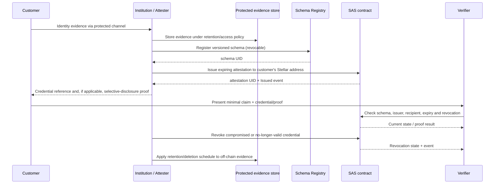

# KYC/AML Attestations on Stellar

This guide describes a privacy-conscious lifecycle for issuing reusable KYC/AML credentials with SAS (Soroban Attestation Service). SAS provides schema registration, on-chain attestations, expiration, revocation, and Merkle primitives; it is not a KYC provider, an identity wallet, a legal determination, nor a zero-knowledge proof system. Institutions remain responsible for diligence, lawful basis, retention, sanctions decisions, and jurisdiction-specific rules.

> **Data minimization:** never put names, dates of birth, document numbers, addresses, screening results, or other direct identifiers in a public Soroban payload. Attestation data is public and durable. Use opaque/random recipient handles only where practical, keep regulated evidence in an access-controlled off-chain system, and disclose only signed, purpose-limited claims to a verifier.

## Credential and schema design

Use stable, versioned schemas with normalized field names and bounded values. Example schema syntax (schema syntax/types are validated by the registry):

```text
u32 tier, string jurisdiction, u64 checked_at, u64 expires_at, bool sanctions_clear, bytes32 evidence_commitment
```

The payload is an assertion, not a dossier. `jurisdiction` should use an agreed ISO 3166-1 alpha-2 code; tier values and timestamp semantics must be documented in the consuming policy. `evidence_commitment` should be a cryptographically random, salted commitment to off-chain evidence, not a hash of predictable personal data. Prefer separate, narrowly-scoped schemas for distinct legal purposes rather than a single catch-all profile. Never encode raw watchlist matches or case notes.

Illustrative tiers (the actual controls must be defined by the regulated institution):

| Tier | Assurance claim | Example refresh cycle |
|---|---|---|
| 1 | Basic identity and minimum customer due diligence | 12 months |
| 2 | Enhanced due diligence / higher-risk relationship | 6 months |
| 3 | Institutional or specialized diligence | 3–12 months, policy-dependent |

These periods are examples, not universal legal requirements. Choose cycles from applicable law, risk, product exposure, and internal policy. `checked_at`/`expires_at` in the payload are useful for application policy; SAS `expiration_time` is authoritative for contract-time validity. Keep them consistent. `expiration_time == 0` means perpetual and is generally inappropriate for changing KYC/AML status.

Schema UIDs are derived from the schema string, resolver address, and revocable flag. Changing any of these yields a different schema identity; version changes should be explicit. Use `revocable: true` for compliance credentials and set a `max_ttl` policy when supported by the deployed registry.

## Lifecycle and architecture



### 1. Register

An authorized institutional account registers the exact schema and resolver policy. Restrict schema administration, document issuer keys and rotation, and publish the schema UID/version to verifiers through an authenticated channel. Registry storage describes the claim format; it does not certify that an issuer is trustworthy.

CLI example:

```sh
cargo run -p soroban-sas-cli -- schema register \
  --schema 'u32 tier, string jurisdiction, u64 checked_at, u64 expires_at, bool sanctions_clear, bytes32 evidence_commitment' \
  --resolver "$RESOLVER_CONTRACT_ID" --revocable true --network testnet
```

### 2. Issue and renew

After performing diligence, issue a credential to the subject's Stellar address with an explicit future `expiration_time`, `revocable: true`, and the registered schema UID. Renewal follows a new review; use SAS replacement when its same-attester/same-recipient and revocability requirements fit, or revoke the old credential and issue a replacement. Do not treat a new credential as evidence that prior adverse records should be erased from systems that have independent retention obligations.

#### Rust SDK construction example

This uses the repository's `soroban-sas-sdk` builder API (SDK workspace version `0.1.0`; Soroban SDK `21.7.7`). The `Env` in this snippet is appropriate for contract-side/test construction. Production institutional submission must use the SDK client's configured RPC, network passphrase and signer; never embed an institution's signing seed in a dApp.

```rust
use soroban_sas_sdk::{AttestationRequestBuilder, SchemaBuilder};
use soroban_sdk::{Bytes, Env};

fn build_kyc(env: &Env, resolver: &str, schema_uid: [u8; 32],
             subject: &str, issuer: &str, now: u64,
             commitment: &[u8; 32]) -> Result<(), soroban_sas_sdk::errors::SdkError> {
    let schema = SchemaBuilder::new()
        .with_schema("u32 tier, string jurisdiction, u64 checked_at, u64 expires_at, bool sanctions_clear, bytes32 evidence_commitment")
        .with_resolver(resolver)
        .with_revocable(true)
        .with_max_ttl(365 * 24 * 60 * 60)
        .build(env)?;
    let _schema_uid = schema.uid; // Register this schema through SchemaRegistry before issuance.

    let data = Bytes::from_slice(env, commitment);
    let request = AttestationRequestBuilder::new()
        .with_recipient(subject)
        .with_attester(issuer)
        .with_schema_uid(schema_uid)
        .with_data(data)
        .with_expiration(now + 180 * 24 * 60 * 60)
        .with_revocable(true)
        .build(env)?;
    let _attestation = request; // Submit via SASClient::attest using the institutional signer.
    Ok(())
}
```

The illustrative payload above uses the 32-byte commitment alone; in a real deployment encode every schema field in the registry's expected Soroban/XDR representation, and test exact serialization against the contract. Builder construction does not register or submit transactions by itself.

#### TypeScript SDK submission example

The repository's `@soroban-sas/sdk` is version `0.1.0` and depends on `@stellar/stellar-sdk ^13.1.0`. `SASClient` supports schema registration, attest, reads and revoke. Supply a wallet signing callback in a browser; the secret-seed option shown in client config is only for controlled server-side use.

```ts
import { SASClient } from "@soroban-sas/sdk";
import type { Attestation } from "@soroban-sas/sdk";

const sas = new SASClient({
  contractId: process.env.SAS_ID!,
  registryContractId: process.env.SCHEMA_REGISTRY_ID!,
  rpcUrl: process.env.STELLAR_RPC_URL!,
  networkPassphrase: process.env.STELLAR_NETWORK_PASSPHRASE!,
  publicKey: issuerPublicKey,
  signTransaction: walletSignTransaction, // use the wallet's supported SEP-43 flow
});
const schema = "u32 tier, string jurisdiction, u64 checked_at, u64 expires_at, bool sanctions_clear, bytes32 evidence_commitment";
const schemaUid = await sas.registerSchema(schema, resolverContractId, true);

const credential: Attestation = {
  uid: "0".repeat(64), // SAS derives/validates content UID: use the SDK's supported UID construction flow.
  schemaUid,
  time: 0,
  expirationTime: Math.floor(Date.now() / 1000) + 180 * 24 * 60 * 60,
  revocationTime: 0,
  refUid: "0".repeat(64),
  recipient: subjectPublicKey,
  attester: issuerPublicKey,
  revocable: true,
  data: Array.from(encodedSchemaPayload),
};
await sas.attest(credential);
```

Before using a particular SDK release, inspect its `Attestation` type and tested payload/UID helpers. In particular, do not assume an all-zero UID is accepted: the contract validates content-addressed UIDs. Compute the canonical UID from schema UID, recipient, attester and exact encoded data per the SDK/contracts, or use the Rust `AttestationRequestBuilder`/a tested SDK helper. The code block illustrates the interface and required lifecycle fields, not a substitute for this serialization step. Never commit credentials, live keys, or real customer payloads in examples.

### 3. Verify

A verifier should check, in this order: trusted schema UID/version; issuer identity against an independently governed allowlist; expected recipient; not-before/`valid_from` if used; expiry; current revocation state; and required tier/jurisdiction/policy claims. Fail closed on RPC errors, unknown schemas, stale indexer data, malformed payloads, or unavailable revocation status. Cache only with a short policy-bounded TTL and re-check for high-risk actions. SAS expiry is a timestamp check and expiration does not emit a revocation event.

For a stored attestation, query/verify by UID and confirm all relevant fields rather than treating mere existence as approval. A signature or Merkle inclusion proof proves integrity/membership, not that diligence was adequate, that the issuer is licensed, or that the credential remains unrevoked.

## Privacy-preserving Merkle disclosures

SAS provides `merkle_root` and `verify_proof` primitives in `soroban-sas-common`; they are library primitives, not a standalone lifecycle registry. See [Batch Attestations](../batch-attestations.md) for exact hash rules. A Merkle commitment can prove membership in a committed set while withholding other leaves. It does **not** conceal data in the disclosed leaf, prove a hidden predicate, or support per-leaf revocation by itself.

Recommended construction:

1. Create a leaf from an opaque credential reference plus schema/version, issuer, expiry and a high-entropy random nonce. Use an unguessable nonce; unsalted hashes of names, phone numbers or predictable IDs are vulnerable to dictionary attacks.
2. Build and retain the tree/proofs in the protected issuer system; publish only root, cohort/version, issuer signature, publication time and expiry. Define a canonical byte encoding and domain separation at the application layer.
3. Give each holder their own leaf preimage and proof through a protected channel. They disclose only that item to the relying party.
4. The verifier checks the issuer-authenticated root, proof using the exact SAS primitive, credential expiry and an independently maintained revocation/status mechanism.
5. Rotate roots on a defined schedule. A removed holder needs an updated root or a separate revocation mechanism; Merkle membership alone cannot signal individual revocation.

Merkle proofs reveal sibling hashes. They are selective membership proofs, not zero-knowledge proofs; never include personal attributes in a leaf unless the disclosure is acceptable. Where the verifier needs to know a tier or jurisdiction, the holder can disclose that attribute and prove its committed encoding, but ordinary SAS Merkle proofs alone do not prove a predicate about an undisclosed value.

## Revocation and right to erasure

For an individual SAS attestation, issue as revocable and call the SAS revoke operation when status changes, evidence is compromised, or an issuer key/decision is invalidated. Track `AttestationRevoked` and reconcile status; preserve sufficient audit evidence only where law and policy permit. Replacement can atomically revoke and issue a new attestation under the contract's replacement rules. For Merkle cohorts, publish a replacement root or use per-credential status/revocation records; do not claim immediate revocation from an old immutable root.

GDPR and similar privacy regimes require contextual legal analysis. Public ledger data is difficult or impossible to erase, so do not place personal data or reversible identifiers on-chain. A hash can still be personal data if linkable or attributable. Keep identity mapping and evidence off-chain with access control, encryption, purpose limitation, retention limits, data-subject request workflow, and documented lawful basis. Deleting off-chain mappings may reduce linkability but does not erase ledger history, proofs, backups, or third-party copies. Consult privacy counsel/DPO before production deployment and perform a DPIA where required. Design credentials to expire and be revocable, but do not represent revocation as erasure.

## Operational best practices

- Separate issuer and schema-admin roles; protect signing keys with HSM or managed custody, rotation, threshold approvals, monitoring, and incident response.
- Minimize claims, version schemas, validate exact serialization, and publish a verifier policy alongside each schema UID.
- Set finite expiry appropriate to risk; renew only after refreshed checks. Apply the same expiry to on-chain metadata and payload claims.
- Build and test a revocation path before launch; indexer/event feeds are useful but should not be the sole authoritative check where latency or availability matters.
- Use testnet/local integration tests for registration, issue, read, expired rejection, revoke, and post-revocation verification. The SDK examples here follow APIs present in this repository; network submission requires deployed, matching contract versions and signer configuration.
- Keep evidence, proof-generation keys, nonces and customer-support mappings encrypted and access-logged. Never log raw payloads or proofs unnecessarily.
- Threat-model issuer compromise, malicious verifier correlation, stale roots, replay, address rotation, and cross-context linkability. Use distinct opaque identifiers/nonces where unlinkability is needed.

## References

- [Attestation lifecycle](../attestations.md)
- [Schema syntax and payloads](../schemas.md)
- [Merkle batch commitments](../batch-attestations.md)
- [Privacy-preserving attestations](../zk-private-attestations.md)
- Rust SDK: `packages/soroban-sas-sdk` (`0.1.0`); TypeScript SDK: `packages/soroban-sas-js` (`0.1.0`)
