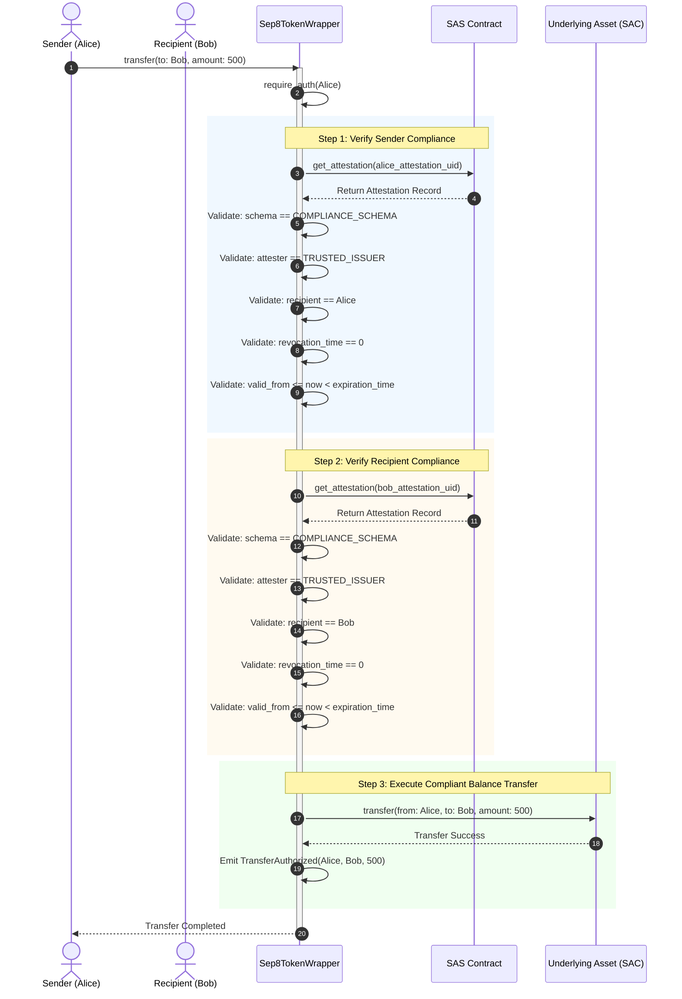

# Stellar SEP-8 Regulated Assets with SAS Attestations

A practical guide for asset issuers, compliance officers, and Soroban smart contract developers implementing **Stellar SEP-8 compliant token restrictions** using the **Stellar Attestation Service (SAS)**.

---

## Table of Contents

1. [Overview & Motivation](#1-overview--motivation)
2. [SEP-8 on Stellar: Classic vs. Soroban SAS](#2-sep-8-on-stellar-classic-vs-soroban-sas)
3. [Architecture & Transfer Authorization Flow](#3-architecture--transfer-authorization-flow)
4. [Compliance Schemas for Regulated Assets](#4-compliance-schemas-for-regulated-assets)
5. [Perpetual vs. Expiring Compliance Certificates](#5-perpetual-vs-expiring-compliance-certificates)
6. [Sample Soroban Token Wrapper Smart Contract](#6-sample-soroban-token-wrapper-smart-contract)
7. [Issuer Revocation Flows & Compliance Updates](#7-issuer-revocation-flows--compliance-updates)
8. [End-to-End Walkthrough for Regulated Token Issuers](#8-end-to-end-walkthrough-for-regulated-token-issuers)
9. [Production Security & Operational Best Practices](#9-production-security--operational-best-practices)

---

## 1. Overview & Motivation

Regulated financial instruments—such as tokenized real-world assets (RWAs), securities, fiat-backed stablecoins, and credit facilities—must satisfy strict jurisdictional compliance standards, including:

- **Know Your Customer (KYC)** and **Anti-Money Laundering (AML)** verification.
- **Accredited investor** verification (e.g., US SEC Regulation D / S).
- **Sanctions screening** (e.g., OFAC, EU sanction lists).
- **Jurisdictional whitelisting/geofencing** (preventing transfers into restricted countries).
- **Transfer velocity limits** and holding period locks.

On Stellar, [SEP-0008](https://github.com/stellar/stellar-protocol/blob/master/ecosystem/sep-0008.md) defines the standard for Regulated Assets. With the advent of **Soroban**, Stellar's WebAssembly-based smart contract platform, issuers can modernize SEP-8 compliance from an off-chain approval server into **programmable, verifiable, and composable on-chain attestations** powered by **SAS (Soroban Attestation Service)**.

---

## 2. SEP-8 on Stellar: Classic vs. Soroban SAS

### Classic Stellar SEP-8 Architecture

In classic Stellar:
1. The asset issuer marks its issuing account with `AUTH_REQUIRED_FLAG` and `AUTH_REVOCABLE_FLAG`.
2. The issuer's `stellar.toml` declares an `approval_server` endpoint.
3. Every payment or path payment transaction containing the regulated asset must be submitted off-chain to the issuer's approval server (via `POST /tx_approve`).
4. The server reviews compliance, cosigns the transaction with an issuer authorization key, and returns the signed transaction to the client for network broadcast.

**Limitations**:
- Single point of failure: If the off-chain approval server goes down, all asset transfers freeze.
- Lack of smart contract composability: Soroban contracts executing cross-contract swaps or DeFi operations cannot synchronously invoke off-chain HTTP approval servers.
- High latency and operational overhead for high-frequency transfers.

### Programmable On-Chain SEP-8 with Soroban & SAS

By combining Soroban smart contract tokens with SAS attestations:
1. **Decentralized & Always Available**: Compliance credentials are represented as cryptographically signed SAS attestations stored on-chain or verified via typed signatures.
2. **Synchronous Contract Verification**: Soroban token wrappers verify investor attestations in real time during `transfer()` or `transfer_from()`.
3. **Atomic Composability**: Automated Market Makers (AMMs), lending protocols, and liquidity pools can seamlessly trade regulated assets without breaking compliance invariants.
4. **Instant Revocability**: If an investor's status changes (e.g., sanctions match), the issuer revokes the attestation on SAS. All subsequent transfers for that investor are blocked immediately on-chain.

| Dimension | Classic Stellar SEP-8 | Soroban + SAS Regulated Token |
| --- | --- | --- |
| **Approval Mechanism** | Off-chain HTTP server cosigning | On-chain SAS attestation verification |
| **Downtime Risk** | Server outage freezes transfers | Decentralized on Stellar validator consensus |
| **Smart Contract Composability** | Weak (off-chain approval needed) | Native (atomic cross-contract checks) |
| **Auditing & Provenance** | Private server logs | Public, immutable ledger events |
| **Revocation Speed** | Dependent on server database update | Atomic on-chain ledger confirmation |

---

## 3. Architecture & Transfer Authorization Flow

The transfer authorization architecture consists of three core components:

1. **SAS Contract (`contracts/sas`)**: Maintains the canonical registry of attestations, recording issuer identity, recipient address, schema UID, expiration timestamp, and revocation state.
2. **Regulated Token Wrapper (`Sep8TokenWrapper`)**: A smart contract token (or wrapper around a Stellar Asset Contract) implementing transfer restrictions. It queries SAS before executing balance mutations.
3. **Compliance Issuer / Oracle**: An authorized entity that performs off-chain KYC/AML diligence and issues or revokes SAS attestations for participant addresses.

### Sequence Diagram: Transfer Authorization Flow



### Authorization Check Invariants

For any transfer from address $S$ (Sender) to address $R$ (Recipient), the wrapper enforces:

$$\forall A \in \{S, R\}, \quad \text{Attestation}(A) = \begin{cases}
\text{schema\_uid} = \text{COMPLIANCE\_SCHEMA} \\
\text{attester} = \text{TRUSTED\_ISSUER} \\
\text{recipient} = A \\
\text{revocation\_time} = 0 \\
\text{valid\_from} \le \text{LedgerTimestamp} \\
\text{expiration\_time} = 0 \quad \lor \quad \text{expiration\_time} > \text{LedgerTimestamp}
\end{cases}$$

If any condition fails for either party, the transaction aborts with an explicit error code and balances remain untouched.

---

## 4. Compliance Schemas for Regulated Assets

A **schema** defines the exact data structure of the compliance credential. Regulated asset issuers define schemas matching their compliance policy.

### Recommended SEP-8 Compliance Schema

```text
kyc_level u32, jurisdiction string, accredited bool, sanctions_cleared bool
```

Field breakdown:
- `kyc_level` (`u32`): Compliance tier (e.g., `1` for basic identity, `2` for enhanced KYC, `3` for institutional).
- `jurisdiction` (`string`): Two-letter ISO-3166 country code of residence (e.g., `"US"`, `"GB"`, `"DE"`).
- `accredited` (`bool`): Whether the participant qualifies as an accredited investor.
- `sanctions_cleared` (`bool`): Affirmation that the address has been vetted against global sanctions watchlists.

### Registering the Schema

The issuer registers the schema once in the `SchemaRegistry` contract:

```bash
cargo run -p soroban-sas-cli -- schema register \
    --schema "kyc_level u32, jurisdiction string, accredited bool, sanctions_cleared bool" \
    --resolver "$RESOLVER_CONTRACT_ID" \
    --revocable true \
    --network testnet
```

The returned 32-byte `schema_uid` is computed deterministically:

$$\text{SchemaUID} = \text{SHA256}(\text{schema\_string} \mathbin{\Vert} \text{resolver\_address} \mathbin{\Vert} \text{revocable\_flag})$$

> [!NOTE]
> Regulated compliance schemas **must always set `revocable: true`**. If a schema is marked non-revocable, issuers cannot legally revoke compromised or sanctioned certificates on-chain.

---

## 5. Perpetual vs. Expiring Compliance Certificates

Compliance certificates in SAS support two temporal modes, controlled by the `expiration_time` field:

```rust
pub struct Attestation {
    pub uid: UID,
    pub schema_uid: UID,
    pub time: u64,
    pub expiration_time: u64,  // 0 = Perpetual, >0 = Expiring (Unix timestamp)
    pub revocation_time: u64,  // 0 = Active, >0 = Revoked
    pub ref_uid: UID,
    pub recipient: Address,
    pub attester: Address,
    pub revocable: bool,
    pub data: Bytes,
    pub valid_from: u64,
}
```

### 1. Perpetual Compliance Certificates (`expiration_time == 0`)

A **perpetual attestation** sets `expiration_time = 0`. It remains valid indefinitely until explicitly revoked.

- **Use cases**:
  - Irreversible one-time legal claims (e.g., corporate identity verification, initial token generation event genesis whitelists).
  - Permanent internal entity authorizations (e.g., issuer treasury wallets, burn sinks).
- **Behavior in contracts**:
  ```rust
  if attestation.expiration_time == 0 {
      // Certificate is perpetual: passes expiry validation unconditionally
  }
  ```
- **Trade-off**: Requires active monitoring and issuer revocation if an entity subsequently falls into non-compliance.

### 2. Expiring Compliance Certificates (`expiration_time > 0`)

An **expiring attestation** specifies a future Unix timestamp (in seconds) beyond which the certificate becomes invalid.

- **Use cases**:
  - **Annual KYC/AML refresh**: Most regulatory bodies require re-verification every 12 to 24 months.
  - **Accredited investor certifications**: Annual income or net-worth verifications typically expire after 1 year.
  - **Time-bound lockups and conditional trading windows**: e.g., temporary exemption valid for 90 days.
- **Behavior in contracts**:
  ```rust
  let now = env.ledger().timestamp();
  if attestation.expiration_time != 0 && attestation.expiration_time <= now {
      panic_with_error!(&env, ComplianceError::CertificateExpired);
  }
  ```
- **Lifecycle & Renewal**:
  - Before the certificate expires, the investor completes their periodic diligence with the issuer.
  - The issuer calls `SAS::replace_attestation` (or issues a new attestation UID), updating the expiration horizon.
  - If not renewed, transfers fail safely without needing manual issuer intervention.

### Comparison Summary

| Attribute | Perpetual Certificate (`expiration_time = 0`) | Expiring Certificate (`expiration_time > 0`) |
| --- | --- | --- |
| **Duration** | Indefinite (valid until revoked) | Deterministic lifespan ($T_{\text{valid}} < T_{\text{exp}}$) |
| **Maintenance** | Low overhead; active issuer revocation | Periodic re-certification cycle |
| **Regulatory Risk** | Higher if periodic audits are required | Minimal; automatic fail-safe expiration |
| **Renewal Flow** | Not applicable | Re-issued or updated via `replace_attestation` |

---

## 6. Sample Soroban Token Wrapper Smart Contract

The following production-ready smart contract demonstrates how a Soroban token wrapper checks SAS attestations prior to approving transfers.

### Implementation: `Sep8TokenWrapper`

```rust
#![no_std]

use soroban_sas_common::{Attestation, UID};
use soroban_sdk::{
    contract, contractclient, contracterror, contractimpl, contracttype, symbol_short,
    Address, BytesN, Env, IntoVal, Symbol,
};

/// Interface to the deployed SAS contract.
#[contractclient(name = "SasClient")]
pub trait SasInterface {
    fn get_attestation(env: Env, uid: UID) -> Option<Attestation>;
    fn verify_attestation(env: Env, uid: UID) -> bool;
}

/// Interface to the underlying standard token (or Stellar Asset Contract).
#[contractclient(name = "TokenClient")]
pub trait TokenInterface {
    fn transfer(env: Env, from: Address, to: Address, amount: i128);
    fn transfer_from(env: Env, spender: Address, from: Address, to: Address, amount: i128);
    fn balance(env: Env, id: Address) -> i128;
}

#[contracterror]
#[derive(Copy, Clone, Debug, Eq, PartialEq, PartialOrd, Ord)]
#[repr(u32)]
pub enum ComplianceError {
    NotInitialized = 1,
    AlreadyInitialized = 2,
    Unauthorized = 3,
    AttestationNotFound = 4,
    InvalidSchema = 5,
    UntrustedIssuer = 6,
    RecipientMismatch = 7,
    CertificateRevoked = 8,
    CertificateExpired = 9,
    CertificateNotYetValid = 10,
    InvalidAmount = 11,
}

#[contracttype]
#[derive(Clone)]
enum DataKey {
    Admin,
    SasContract,
    ComplianceSchema,
    TrustedIssuer,
    UnderlyingToken,
    UserAttestation(Address),
}

const TOPIC_TRANSFER: Symbol = symbol_short!("TRANSFER");
const TOPIC_COMPLIANCE: Symbol = symbol_short!("COMPLY");

#[contract]
pub struct Sep8TokenWrapper;

#[contractimpl]
impl Sep8TokenWrapper {
    /// Initializes the token wrapper with compliance parameters.
    pub fn initialize(
        env: Env,
        admin: Address,
        sas_contract: Address,
        compliance_schema: BytesN<32>,
        trusted_issuer: Address,
        underlying_token: Address,
    ) {
        if env.storage().instance().has(&DataKey::Admin) {
            soroban_sdk::panic_with_error!(&env, ComplianceError::AlreadyInitialized);
        }

        admin.require_auth();

        env.storage().instance().set(&DataKey::Admin, &admin);
        env.storage().instance().set(&DataKey::SasContract, &sas_contract);
        env.storage().instance().set(&DataKey::ComplianceSchema, &compliance_schema);
        env.storage().instance().set(&DataKey::TrustedIssuer, &trusted_issuer);
        env.storage().instance().set(&DataKey::UnderlyingToken, &underlying_token);
    }

    /// Associates an account with its active SAS compliance attestation UID.
    /// Can be updated by the account holder or the authorized admin.
    pub fn set_compliance_attestation(
        env: Env,
        account: Address,
        attestation_uid: BytesN<32>,
    ) {
        let admin: Address = env.storage().instance().get(&DataKey::Admin).unwrap();
        if !account.require_auth().is_ok() {
            admin.require_auth();
        }

        // Verify the attestation is valid before storing the link
        Self::verify_compliance(&env, &account, &attestation_uid);

        env.storage().persistent().set(&DataKey::UserAttestation(account.clone()), &attestation_uid);

        env.events().publish(
            (TOPIC_COMPLIANCE, account),
            attestation_uid,
        );
    }

    /// Executes a compliant transfer from `from` to `to`.
    ///
    /// Verifies on-chain SAS attestations for both sender and recipient.
    pub fn transfer(
        env: Env,
        from: Address,
        to: Address,
        amount: i128,
    ) {
        if amount <= 0 {
            soroban_sdk::panic_with_error!(&env, ComplianceError::InvalidAmount);
        }

        from.require_auth();

        // 1. Fetch registered attestation UIDs
        let from_uid = Self::get_user_attestation_or_panic(&env, &from);
        let to_uid = Self::get_user_attestation_or_panic(&env, &to);

        // 2. Perform atomic compliance verification
        Self::verify_compliance(&env, &from, &from_uid);
        Self::verify_compliance(&env, &to, &to_uid);

        // 3. Forward the transfer to the underlying asset
        let underlying: Address = env.storage().instance().get(&DataKey::UnderlyingToken).unwrap();
        let token_client = TokenClient::new(&env, &underlying);
        token_client.transfer(&from, &to, &amount);

        // 4. Emit compliance transfer event
        env.events().publish(
            (TOPIC_TRANSFER, from, to),
            amount,
        );
    }

    /// Executes a delegated transfer (`transfer_from`) with compliance verification.
    pub fn transfer_from(
        env: Env,
        spender: Address,
        from: Address,
        to: Address,
        amount: i128,
    ) {
        if amount <= 0 {
            soroban_sdk::panic_with_error!(&env, ComplianceError::InvalidAmount);
        }

        spender.require_auth();

        let from_uid = Self::get_user_attestation_or_panic(&env, &from);
        let to_uid = Self::get_user_attestation_or_panic(&env, &to);

        Self::verify_compliance(&env, &from, &from_uid);
        Self::verify_compliance(&env, &to, &to_uid);

        let underlying: Address = env.storage().instance().get(&DataKey::UnderlyingToken).unwrap();
        let token_client = TokenClient::new(&env, &underlying);
        token_client.transfer_from(&spender, &from, &to, &amount);

        env.events().publish(
            (TOPIC_TRANSFER, from, to),
            amount,
        );
    }

    /// Query the compliance status of an account. Returns `true` if compliant.
    pub fn is_compliant(env: Env, account: Address) -> bool {
        let key = DataKey::UserAttestation(account.clone());
        if let Some(uid) = env.storage().persistent().get::<DataKey, BytesN<32>>(&key) {
            Self::check_compliance(&env, &account, &uid).is_ok()
        } else {
            false
        }
    }

    // --- Internal Verification Logic ---

    fn get_user_attestation_or_panic(env: &Env, account: &Address) -> BytesN<32> {
        let key = DataKey::UserAttestation(account.clone());
        env.storage().persistent().get(&key).unwrap_or_else(|| {
            soroban_sdk::panic_with_error!(env, ComplianceError::AttestationNotFound);
        })
    }

    fn verify_compliance(env: &Env, account: &Address, uid_bytes: &BytesN<32>) {
        if let Err(err) = Self::check_compliance(env, account, uid_bytes) {
            soroban_sdk::panic_with_error!(env, err);
        }
    }

    fn check_compliance(
        env: &Env,
        account: &Address,
        uid_bytes: &BytesN<32>,
    ) -> Result<(), ComplianceError> {
        let sas_address: Address = env.storage().instance().get(&DataKey::SasContract).unwrap();
        let expected_schema: BytesN<32> = env.storage().instance().get(&DataKey::ComplianceSchema).unwrap();
        let trusted_issuer: Address = env.storage().instance().get(&DataKey::TrustedIssuer).unwrap();

        let sas_client = SasClient::new(env, &sas_address);
        let uid = UID(uid_bytes.clone());

        // 1. Retrieve attestation from SAS
        let attestation = sas_client
            .get_attestation(&uid)
            .ok_or(ComplianceError::AttestationNotFound)?;

        // 2. Validate attestation binds to the exact account
        if attestation.recipient != *account {
            return Err(ComplianceError::RecipientMismatch);
        }

        // 3. Validate matching compliance schema
        if attestation.schema_uid.0 != expected_schema {
            return Err(ComplianceError::InvalidSchema);
        }

        // 4. Validate trusted compliance issuer
        if attestation.attester != trusted_issuer {
            return Err(ComplianceError::UntrustedIssuer);
        }

        // 5. Verify non-revocation
        if attestation.revocation_time != 0 {
            return Err(ComplianceError::CertificateRevoked);
        }

        let now = env.ledger().timestamp();

        // 6. Verify valid_from activation window
        if attestation.valid_from != 0 && now < attestation.valid_from {
            return Err(ComplianceError::CertificateNotYetValid);
        }

        // 7. Verify expiration time (0 = Perpetual; >0 = Expiring)
        if attestation.expiration_time != 0 && now >= attestation.expiration_time {
            return Err(ComplianceError::CertificateExpired);
        }

        Ok(())
    }
}
```

---

## 7. Issuer Revocation Flows & Compliance Updates

In regulated financial environments, compliance status is non-static. An investor may:
1. Fail an ongoing AML screening or be added to an international sanctions list.
2. Experience account key compromise or fraudulent takeover.
3. Lose their accredited investor status due to changed net-worth or income thresholds.
4. Relocate to a prohibited jurisdiction.

### Immediate On-Chain Revocation

When a compliance change occurs, the issuer revokes the attestation directly in SAS:

```bash
cargo run -p soroban-sas-cli -- attest revoke \
    --uid "$ALICE_ATTESTATION_UID" \
    --network testnet
```

Under the hood, `SAS::revoke` executes:

```rust
pub fn revoke(env: Env, uid: UID) {
    let mut attestation = read_attestation(&env, &uid).expect("AttestationNotFound");
    attestation.attester.require_auth(); // Only the issuer can revoke
    
    attestation.revocation_time = env.ledger().timestamp();
    write_attestation(&env, &uid, &attestation);
    
    env.events().publish((symbol_short!("REVOKED"), uid), attestation.revocation_time);
}
```

### Immediate Transfer Freeze Effect

Because `Sep8TokenWrapper` verifies `attestation.revocation_time == 0` dynamically on every transfer:
- The revocation takes effect **in the exact same ledger block** where `SAS::revoke` confirms.
- If Alice attempts to transfer tokens 1 second after revocation, the wrapper contract encounters `attestation.revocation_time != 0` and panics with `ComplianceError::CertificateRevoked`.
- **No manual contract pausing or blacklist synchronization is needed.** The single source of truth in SAS guarantees instant, network-wide restriction.

### Revocation Delegation

If the issuer employs an automated compliance bot or delegated key management:

```rust
// Revoke using an authorized delegate key
SAS::revoke_by_authorizer(env, uid, delegate_address);

// Or revoke via an off-chain signed message (relayer gas payment)
SAS::revoke_by_delegation(env, uid, nonce, signature, public_key);
```

### Remediation & Re-Issuance

If a revocation occurred due to a temporary false positive (e.g., name-match false alarm during sanctions audit):
1. The compliance officer clears the user.
2. The issuer generates and publishes a **new attestation UID** with updated data.
3. The user or admin calls `set_compliance_attestation(user, new_uid)`.
4. Transfers resume immediately.

---

## 8. End-to-End Walkthrough for Regulated Token Issuers

Follow these steps to deploy and operate an on-chain SEP-8 compliant regulated asset.

### Step 1: Deploy Core SAS & Schema Registry

If not using an existing deployment, deploy the core contracts to Stellar Testnet:

```bash
# 1. Deploy Schema Registry
stellar contract deploy \
    --wasm target/wasm32-unknown-unknown/release/schema_registry.wasm \
    --source issuer \
    --network testnet

# 2. Deploy SAS
stellar contract deploy \
    --wasm target/wasm32-unknown-unknown/release/sas.wasm \
    --source issuer \
    --network testnet
```

### Step 2: Register Compliance Schema

Register the SEP-8 compliance schema:

```bash
SCHEMA_STRING="kyc_level u32, jurisdiction string, accredited bool, sanctions_cleared bool"
RESOLVER_ADDRESS="$PERMISSIVE_RESOLVER_ID"

stellar contract invoke \
    --id "$SCHEMA_REGISTRY_ID" \
    --source issuer \
    --network testnet \
    -- register \
    --schema "$SCHEMA_STRING" \
    --resolver "$RESOLVER_ADDRESS" \
    --revocable true
```

Record the output `SCHEMA_UID`.

### Step 3: Deploy the Regulated Token Wrapper

Deploy `Sep8TokenWrapper` and initialize it with your compliance parameters:

```bash
stellar contract invoke \
    --id "$WRAPPER_CONTRACT_ID" \
    --source issuer \
    --network testnet \
    -- initialize \
    --admin "$ISSUER_ADDRESS" \
    --sas_contract "$SAS_CONTRACT_ID" \
    --compliance_schema "$SCHEMA_UID" \
    --trusted_issuer "$ISSUER_ADDRESS" \
    --underlying_token "$USDC_SAC_CONTRACT_ID"
```

### Step 4: Issue Attestations to Investors

#### Issuing an Expiring KYC Certificate (1 Year Validity)

Using the SAS Rust SDK:

```rust
use soroban_sas_sdk::attestation_builder::AttestationRequestBuilder;
use soroban_sas_sdk::client::SASClient;

// Calculate 365-day expiry
let current_time = std::time::SystemTime::now()
    .duration_since(std::time::UNIX_EPOCH)
    .unwrap()
    .as_secs();
let one_year_expiry = current_time + (365 * 86400);

let request = AttestationRequestBuilder::new()
    .schema_uid(schema_uid)
    .recipient(alice_address)
    .expiration_time(one_year_expiry)
    .revocable(true)
    .data(compliance_payload_bytes)
    .build();

let uid = sas_client.attest(&request).await?;
println!("Issued Expiring Certificate to Alice: {:?}", uid);
```

#### Issuing a Perpetual Certificate

For institutional treasury accounts or permanent partners:

```rust
let request = AttestationRequestBuilder::new()
    .schema_uid(schema_uid)
    .recipient(treasury_address)
    .expiration_time(0) // 0 = Perpetual certificate
    .revocable(true)
    .data(compliance_payload_bytes)
    .build();

let uid = sas_client.attest(&request).await?;
println!("Issued Perpetual Certificate to Treasury: {:?}", uid);
```

### Step 5: Link User Attestations to the Token Wrapper

Alice links her certificate to the token contract:

```bash
stellar contract invoke \
    --id "$WRAPPER_CONTRACT_ID" \
    --source alice \
    --network testnet \
    -- set_compliance_attestation \
    --account "$ALICE_ADDRESS" \
    --attestation_uid "$ALICE_UID"
```

Bob does the same with his compliance certificate (`$BOB_UID`).

### Step 6: Execute a Compliant Transfer

Alice sends 100 regulated tokens to Bob:

```bash
stellar contract invoke \
    --id "$WRAPPER_CONTRACT_ID" \
    --source alice \
    --network testnet \
    -- transfer \
    --from "$ALICE_ADDRESS" \
    --to "$BOB_ADDRESS" \
    --amount 1000000000
```

The transfer succeeds atomically: both Alice and Bob are verified on SAS in real time.

### Step 7: Verify Rejection on Revocation

If Alice's compliance is revoked:

```bash
# Issuer revokes Alice's compliance attestation
stellar contract invoke \
    --id "$SAS_CONTRACT_ID" \
    --source issuer \
    --network testnet \
    -- revoke \
    --uid "$ALICE_UID"
```

When Alice attempts another transfer:

```bash
stellar contract invoke \
    --id "$WRAPPER_CONTRACT_ID" \
    --source alice \
    --network testnet \
    -- transfer \
    --from "$ALICE_ADDRESS" \
    --to "$BOB_ADDRESS" \
    --amount 500000000
```

**Result**: The transaction immediately aborts with:
`Error(Contract, #8)` (`ComplianceError::CertificateRevoked`). No funds move.

---

## 9. Production Security & Operational Best Practices

### 1. Storage TTL Management
Soroban employs state expiration. When an attestation is queried via `SAS::get_attestation`, SAS automatically extends the entry's storage TTL. However, issuers should ensure their wrapper contracts use `persistent()` storage for user attestation mappings and monitor TTL thresholds in high-volume production deployments.

### 2. Off-Chain Signature Relays (Gasless Issuance)
To prevent users from needing XLM gas to receive initial compliance certificates, issuers can leverage `SAS::attest_by_delegation`. The compliance authority signs the attestation off-chain with its ed25519 key, and a relayer submits the transaction on-chain.

### 3. Separation of Concerns: Resolvers vs. Wrappers
Keep custom compliance policy (such as fee requirements or transfer velocity counters) modular:
- Use **SAS Resolvers** (`on_attest`) to validate schema-specific data when the claim is minted.
- Use the **Token Wrapper** to enforce dynamic sender/recipient pairing at transfer time.

### 4. Integration with Stellar Asset Contract (SAC) Clawback
For full legal compliance, issuers of regulated tokens should enable the `clawback_enabled` flag on the underlying Stellar Asset. If an account is legally seized or court-ordered to forfeiture, the issuer can execute an administrative clawback through the SAC interface in parallel with SAS attestation revocation.

---

## References

- [Stellar SEP-0008 Specification](https://github.com/stellar/stellar-protocol/blob/master/ecosystem/sep-0008.md)
- [Soroban Smart Contract Documentation](https://developers.stellar.org/docs/smart-contracts)
- [SAS Architecture Documentation](../architecture.md)
- [SAS Attestation Lifecycle Guide](../attestations.md)
- [SAS Schema Design Guide](../schemas.md)
