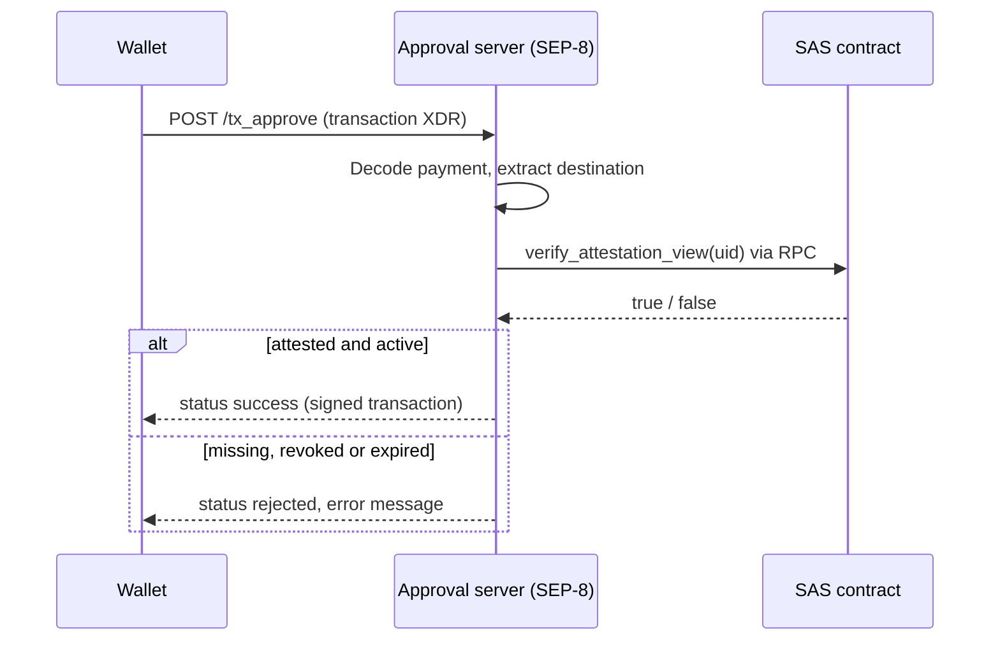

# Example Integration with Stellar SEP-8

[SEP-8](https://github.com/stellar/stellar-protocol/blob/master/ecosystem/sep-0008.md)
defines regulated assets: an issuer runs an approval server that must approve
every transaction that moves the asset. SAS attestations can be the evidence
the approval server checks, for example "the receiver passed KYC".

This is an integration pattern, not a bundled server. The approval server
lives in your infrastructure; SAS is queried read-only.

## Flow



## Setup

1. Register a schema such as `bool kyc_passed` with the issuer as owner and
   `--revocable`, so a failed review can be withdrawn.
2. Issue an attestation to each approved account. Give it an `expiration`
   matching your review period.
3. Compute the UID for a destination with the SDK, which uses the same
   content-addressed derivation as the contract.
4. The approval server calls `verify_attestation_view`, which does not renew
   storage rent and is safe to call per request.

```sh
soroban-sas attest attest \
  --schema-uid <KYC_SCHEMA_UID> \
  --recipient G... \
  --data 01 \
  --expiration 1900000000 \
  --revocable \
  --contract-id C...
```

## Approval logic

```rust
// Pseudocode for the approval handler.
let destination = payment_destination(&tx)?;          // from the SEP-8 transaction
let uid = kyc_uid_for(&destination);                   // soroban_sas_common::attestation_uid
match sas.verify_attestation_view(&uid) {
    true => Approve(sign(tx)),
    false => Reject("destination has no active KYC attestation"),
}
```

`verify_attestation_view` returns `false` for unknown, revoked, not yet valid
and expired attestations, so the handler needs only one branch for rejection.

## Operational guidance

- Fail closed: if the RPC call errors, answer `rejected` or `pending`, never
  `success`.
- Pin the schema UID and issuer in configuration. Do not accept an attestation
  from any other schema or attester.
- Pair this with `SAS::get_issuance_timestamp` if you need to bind a decision to
  a ledger for audits.
- Use short expirations so a revoked or lapsed account stops passing
  automatically even if a revocation is missed.
