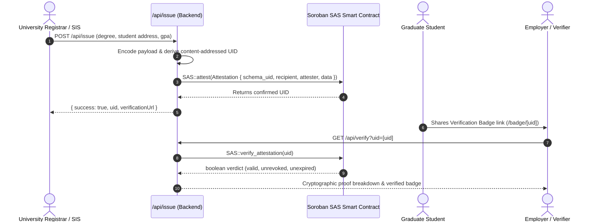

# Soroban SAS Academic Credentials dApp Reference Example

> **Turnkey reference decentralized application demonstrating how educational degrees and skill certifications can be issued, managed, and verified as non-transferable on-chain attestations on the Stellar network using Soroban SAS.**

[](LICENSE)
[](https://github.com/APKLEO/soroban-sas)
[](https://nextjs.org/)
[](https://www.typescriptlang.org/)
[](https://tailwindcss.com/)

---

## Table of Contents

1. [Overview & Problem Statement](#overview--problem-statement)
2. [Key Capabilities](#key-capabilities)
3. [Standard Academic Credential Schema](#standard-academic-credential-schema)
4. [Architecture & Automated Issuance Flow](#architecture--automated-issuance-flow)
5. [Quickstart: Running Locally with Mock Testnet Data](#quickstart-running-locally-with-mock-testnet-data)
6. [Preloaded Mock Test Cases](#preloaded-mock-test-cases)
7. [Automated Backend API Reference](#automated-backend-api-reference)
8. [Stellar Testnet & Smart Contract Deployment](#stellar-testnet--smart-contract-deployment)
9. [Project Structure](#project-structure)

---

## Overview & Problem Statement

Academic credential fraud, degree counterfeiting, and slow paper-based employment verification cost institutions and employers billions of dollars annually.

This reference dApp demonstrates how universities and certification authorities can leverage the **Soroban Attestation Service (`soroban-sas`)** to:
1. **Issue non-transferable, tamper-evident degree credentials** bound directly to a graduate's Stellar public key (`G...`).
2. **Automate issuance** through registrar Student Information Systems (SIS) via a secure backend API.
3. **Provide employers and background check agencies** with a self-service public verification portal and shareable digital verification badges.
4. **Enforce revocation** on-chain when a degree is rescinded due to academic infractions or clerical errors.

---

## Key Capabilities

* 🏛️ **University Admin Portal** (`/admin`):
  * Issue academic credentials to student Stellar addresses with degree metadata.
  * Quick-fill presets for rapid evaluation (MIT, Stanford, Stellar Academy).
  * On-chain revocation management table.
* 🛡️ **Public Verification Portal** (`/verify`):
  * Query by 64-character Attestation UID or Student Stellar address.
  * Real-time verification breakdown checking:
    * Contract state persistence
    * Non-transferable recipient address binding
    * University authority signature authenticity
    * Expiration timestamp checks
    * On-chain revocation status
* 🎓 **Public Verification Badge & Embeds** (`/badge/[uid]`):
  * Certificate-style verification card with verifiable status seals (`VALID`, `REVOKED`, `EXPIRED`).
  * One-click embed snippet for inclusion in personal portfolios, resumes, and LinkedIn.
* 🎒 **Student / Graduate Backpack** (`/student`):
  * View all degrees, honors, and certifications conferred to a specific Stellar address.
* 🤖 **Automated Backend Issuance API** (`/api/issue`):
  * REST API endpoint enabling automated SIS/ERP pipelines to issue credentials programmatically.

---

## Standard Academic Credential Schema

The dApp implements the standard academic credential schema registered with the Soroban SAS Schema Registry:

```text
degree String, institution String, graduation_year u32, gpa String
```

### Schema Fields

| Field Name | Type | Description | Example |
| :--- | :--- | :--- | :--- |
| `degree` | `String` | Formal degree or certification title | `"Bachelor of Science in Computer Science"` |
| `institution` | `String` | Accredited issuing university or authority | `"Massachusetts Institute of Technology (MIT)"` |
| `graduation_year`| `u32` | Calendar year of degree conferral | `2024` |
| `gpa` | `String` | Grade point average or classification | `"3.94 / 4.0"` or `"Summa Cum Laude"` |

Additional optional metadata (student name, academic honors, registrar SIS serial number) are structured in the UTF-8 payload.

### Content-Addressed UID Derivation

Every attestation UID is deterministically derived matching `soroban_sas_common::attestation_uid`:

$$\text{UID} = \text{SHA-256}\Big(\text{xdr}(\text{schema\_uid}) \parallel \text{xdr}(\text{recipient}) \parallel \text{xdr}(\text{attester}) \parallel \text{xdr}(\text{data})\Big)$$

---

## Architecture & Automated Issuance Flow



---

## Quickstart: Running Locally with Mock Testnet Data

The dApp includes a built-in mock engine with pre-populated test data, allowing it to run offline without any external testnet configuration.

### 1. Prerequisites
- **Node.js**: v18.0.0 or later (tested up to Node v24)
- **npm**: v9.0.0 or later

### 2. Installation

Navigate into the example directory and install dependencies:

```bash
cd examples/academic-credentials
npm install
```

### 3. Start Development Server

```bash
npm run dev
```

Open [http://localhost:3000](http://localhost:3000) in your browser.

---

## Preloaded Mock Test Cases

The dApp includes preloaded test cases illustrating different attestation lifecycles in the **Verification Portal** (`/verify`):

| Test Case | Degree / Institution | Attestation UID | Status |
| :--- | :--- | :--- | :--- |
| **Active Valid Degree** | B.S. in Computer Science (MIT) | `a1c8901f44e1837d99be8217354921dfbc85e78393c042078bb0920412df7189` | `VALID` |
| **Active Valid Degree** | M.S. in AI (Stanford) | `b890f551c4a2371289de0487561849aed0398410294821aefb90428174591a23` | `VALID` |
| **Revoked Degree** | Smart Contract Dev (Stellar Academy) | `d4e5f6a7b8c9d0e1f2a3b4c5d6e7f8a9b0c1d2e3f4a5b6c7d8e9f0a1b2c3d4e5` | `REVOKED` |
| **Expired Certificate**| Quant Finance (Harvard) | `c3d4e5f6a7b8c9d0e1f2a3b4c5d6e7f8a9b0c1d2e3f4a5b6c7d8e9f0a1b2c3d4` | `EXPIRED` |

---

## Automated Backend API Reference

### 1. Issue Credential
* **Endpoint**: `POST /api/issue`
* **Content-Type**: `application/json`

**Request Body**:
```json
{
  "recipient": "GA7QYNF7SOWQ3GLR2BGMZEHXAVIRZA4KVWLTJJFC7MGXUA74P7UJVXYZ",
  "degree": "Bachelor of Science in Computer Science",
  "institution": "Massachusetts Institute of Technology (MIT)",
  "graduation_year": 2024,
  "gpa": "3.94 / 4.0",
  "student_name": "Alex Thorne",
  "honors": "Summa Cum Laude",
  "credential_id": "MIT-EECS-2024-8842",
  "expiration_days": 0,
  "revocable": true
}
```

**Response**:
```json
{
  "success": true,
  "message": "Academic credential issued successfully as a non-transferable Soroban attestation.",
  "uid": "a1c8901f44e1837d99be8217354921dfbc85e78393c042078bb0920412df7189",
  "verificationUrl": "/badge/a1c8901f44e1837d99be8217354921dfbc85e78393c042078bb0920412df7189"
}
```

### 2. Verify Credential
* **Endpoint**: `GET /api/verify?uid={attestation_uid}`
* **Response**:
```json
{
  "valid": true,
  "status": "VALID",
  "reason": "Attestation verified: Signature, expiration, and revocation status are fully valid.",
  "checkedAt": "2026-10-22T07:00:00.000Z",
  "isMock": true,
  "network": "Mock Testnet"
}
```

### 3. Revoke Credential
* **Endpoint**: `POST /api/revoke`
* **Request Body**:
```json
{
  "uid": "a1c8901f44e1837d99be8217354921dfbc85e78393c042078bb0920412df7189"
}
```

---

## Stellar Testnet & Smart Contract Deployment

To switch from Mock Mode to live Stellar Testnet:

1. Copy `.env.example` to `.env.local`:
   ```bash
   cp .env.example .env.local
   ```
2. Set `NEXT_PUBLIC_USE_MOCK_DATA=false`.
3. Provide your deployed SAS Smart Contract addresses:
   ```env
   NEXT_PUBLIC_STELLAR_NETWORK=TESTNET
   NEXT_PUBLIC_SOROBAN_RPC_URL=https://soroban-testnet.stellar.org
   NEXT_PUBLIC_SAS_CONTRACT_ID=C...
   NEXT_PUBLIC_SCHEMA_REGISTRY_ID=C...
   NEXT_PUBLIC_ACADEMIC_SCHEMA_UID=e3b0c44298fc1c149afbf4c8996fb92427ae41e4649b934ca495991b7852b855
   UNIVERSITY_ISSUER_SECRET_KEY=S...
   ```

---

## Project Structure

```text
examples/academic-credentials/
├── src/
│   ├── app/
│   │   ├── layout.tsx             # Root layout with navigation & branding
│   │   ├── page.tsx               # Landing page with interactive badge showcase
│   │   ├── admin/page.tsx         # University Admin Portal (Issuance & Revocation)
│   │   ├── verify/page.tsx        # Public Verification Portal (Inspect & Authenticate)
│   │   ├── badge/[uid]/page.tsx   # Shareable & embeddable Public Verification Badge
│   │   ├── student/page.tsx       # Student / Graduate Credential Backpack
│   │   └── api/
│   │       ├── issue/route.ts     # Automated backend issuance API
│   │       ├── verify/route.ts    # Verification engine API
│   │       ├── credentials/route.ts # Credential lookup by student or UID
│   │       └── revoke/route.ts    # On-chain revocation API
│   ├── components/
│   │   ├── CredentialBadge.tsx    # Digital verification badge with embed generator
│   │   ├── IssueForm.tsx          # University credential issuance form
│   │   ├── VerificationResult.tsx # Cryptographic proof inspector
│   │   ├── Navbar.tsx             # Main header & network indicator
│   │   └── Footer.tsx             # Footer & schema specifications
│   └── lib/
│       ├── sas/
│       │   ├── schema.ts          # Academic credential schema encoders & validators
│       │   ├── crypto.ts          # Content-addressed UID derivation
│       │   ├── client.ts          # Unified Soroban SAS Client
│       │   └── types.ts           # Protocol types & data models
│       └── store/
│           └── mockData.ts        # Preloaded offline testnet data & credentials
├── package.json                   # Dependencies (@stellar/stellar-sdk, next, tailwind)
├── tsconfig.json                  # TypeScript configuration
├── tailwind.config.js             # Styling configuration
└── README.md                      # Comprehensive documentation
```

---

## License

This reference implementation is licensed under the [MIT License](../../LICENSE).
